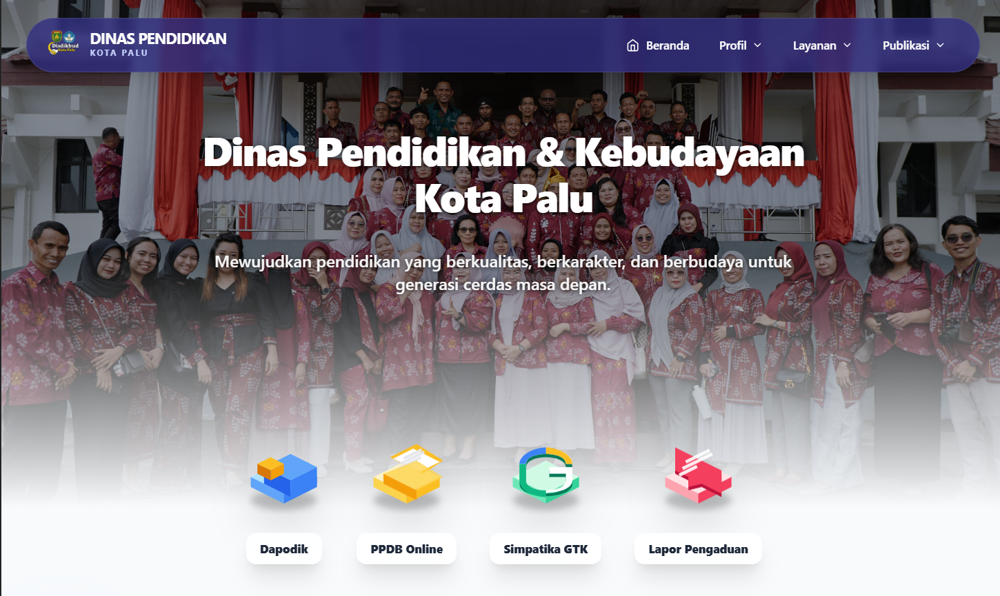
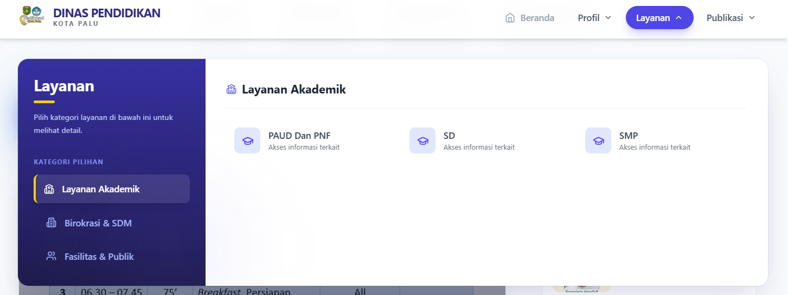
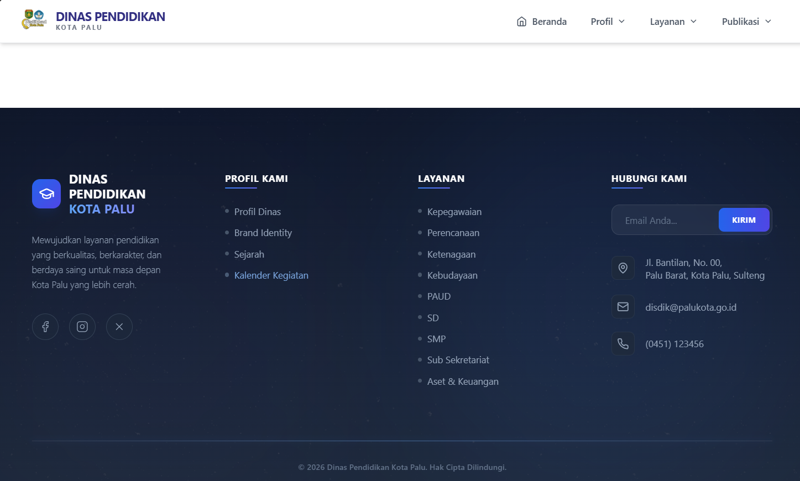
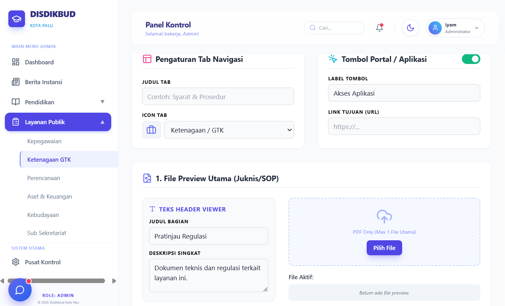
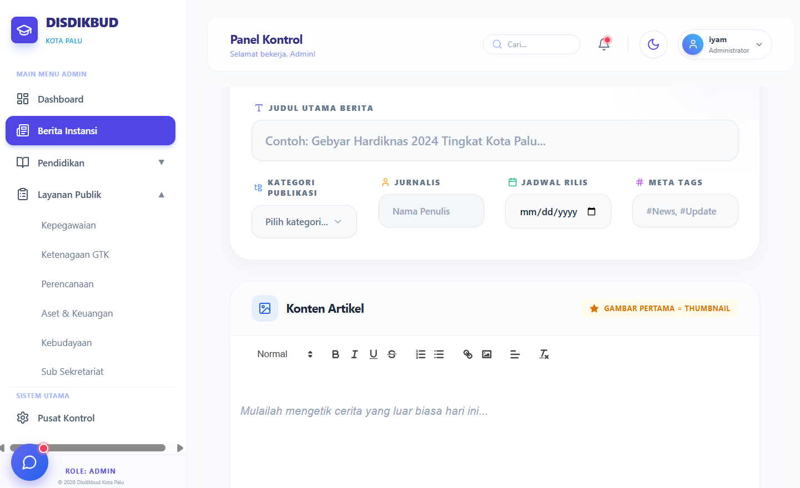

# 🏫 Website Resmi Dinas Pendidikan dan Kebudayaan Kota Palu

Aplikasi portal publik modern berbasis web yang dirancang untuk menyajikan informasi pendidikan, layanan publik, berita terkini, serta panel manajemen data terintegrasi di Kota Palu.

---

## 📸 TAMPILAN

### 1. Antarmuka Publik (Public View)

#### 🔹 Landing Page Utama

*Tampilan banner utama (Hero Section) dan navigasi layanan publik Dinas Pendidikan dan Kebudayaan Kota Palu.*

#### 🔹 Navigasi & Layanan Biromaru

*Struktur menu navigasi yang responsif beserta daftar layanan instansi.*

#### 🔹 Bagian Footer & Informasi Kontak

*Tautan cepat, peta situs, serta saluran informasi resmi instansi.*

---

### 2. Panel Administrasi & Pengelolaan Data (Admin Dashboard)

#### 🔹 Manajemen Data & Form Input (CRUD)

*Tampilan antarmuka dashboard admin untuk pengelolaan dan inventarisasi data instansi.*

#### 🔹 Editor Konten & Publikasi Berita

*Fitur pengisian form dinamis dan rich text editor untuk mengunggah konten/pengumuman resmi.*

---

## 🛠️ Teknologi yang Digunakan

- **Frontend:** React, TypeScript, Tailwind CSS, Vite
- **Backend:** Laravel, RESTful API
- **Database:** MySQL

---

## 🚀 Fitur Utama

- ⚡ **Fast & Responsive UI:** Menggunakan React SPA (Single Page Application) dengan Tailwind CSS.
- 📰 **Portal Publik Dinamis:** Menyajikan berita, pengumuman, dan layanan edukasi publik secara *real-time*.
- 🔐 **Management Panel (CRUD):** Integrasi penuh REST API Laravel untuk pengelolaan konten, data sekolah, dan pengumuman.

---

## 💻 Cara Menjalankan Project di Lokal

### 1. Backend (Laravel)
```bash
cd backend
composer install
cp .env.example .env
```
### 1. Frontend (React + Vite)
```bash
cd frontend
npm install
cp .env.example .env
npm run dev

php artisan key:generate
php artisan migrate --seed
php artisan serve
